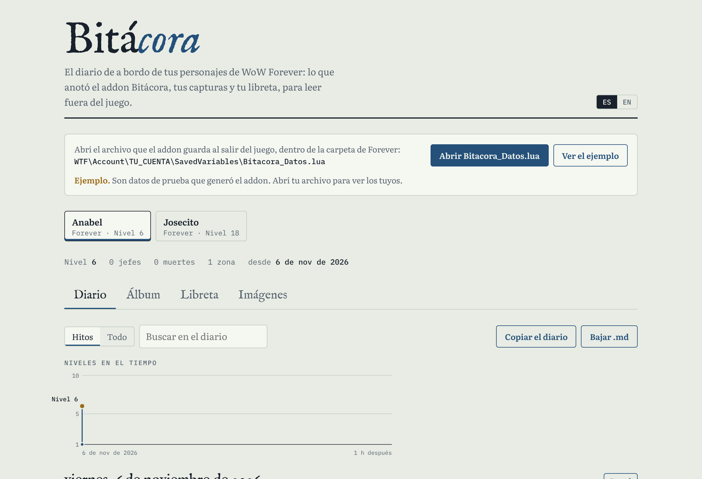

# Bitácora

A logbook for your **WoW Forever** characters: a notebook, a journal that writes itself, a screenshot album and reminders, in one window, plus a web page to read it all outside the game.

[Leer en castellano](README.md)

**The web page, live:** [Bitácora](https://joseargento.github.io/bitacora/) · [Tavern](https://joseargento.github.io/bitacora/taberna.html)

- **Notebook**: notes with your own tabs and search, for all characters or one; shift-click links items, quests and achievements. Notes can be **attached** to an NPC (your target), a linked item or a zone: they show in the NPC's or item's tooltip, and you get a chat line when you enter the zone. Up to 4 **images** per note.
- **Journal**: written for you. Levels, first visit of each zone, bosses (first kills marked), deaths, quests, loot of the quality you choose, achievements, gold (1/10/100/1000), time played, and your own entries. A "milestones" filter reads it like a story. Forever's own things too: **Legacy challenges** with their points, your **first campsite** and every camping **blueprint** you learn. Coming back to a character after a few days (2 by default), one chat line says **where you were**: when, where, what level, your last note.
- **Album**: every screenshot (Print Screen) is noted with when, where, level and who you were with; add a caption. The web page pairs the notes with the photos.
- **Progress**: your numbers (days played, zones, quests, bosses, first kills, loot, deaths, where you died most, Legacy points for the character and the account), every dungeon and raid of the game's Adventure Guide with how many bosses you killed, achievements by category, **time per level** (with the account's fastest character for each level; `/played` re-anchors the count) and **companions** (who you grouped with, account-wide: class, groups shared, last seen where; capped at 500).
- **Guild chronicle** (off unless you turn it on): your milestones go to guildmates who have Bitácora, and you see theirs.
- **Reminders**: "6 hours before the weekly reset", "when I enter Ironforge", "at level 40", "when I open the mailbox", "when I log in", "Tuesdays at 20:30"; per character or for all, once or repeating. Center-screen alert with sound, plus a small popup with **snooze** (5, 10 or 15 min; can be turned off). Day-and-time reminders follow your computer's clock or the realm's (an option); one that came due while you were logged out fires at login, once, looking back up to 30 days since the addon last ran. Officers (ranks 0-1) can send day-and-time reminders to the whole guild; they pop at the same moment for everyone, shown in local time. **The game's calendar:** at login it reads the guild events (and the ones you were invited to) of the next 7 days and asks, once per new event, "Remind you before «Onyxia» (Thu 12/11 20:30)?" with Yes / No / Always ("Always" makes them without asking; an option turns it off); the reminder rings 60 minutes before, in your local time. **Whispered reminders:** `/bita to Pepito: bring water` sends one to a guildmate or friend as an addon message on the whisper channel and it rings on their side right away; only guildmates and friends are listened to, anyone else is ignored silently. **Campsite:** 5 minutes before the campsite buff ends it says so (an option turns it off; ⏳ Forever's spell and buff IDs are not known yet, so they are matched by name).

Open it with `/bitacora` (or `/bita`), a key binding, **its round button on the minimap's edge** (click: the book; right click: options; drag it around the minimap, hide it in Options) or the addon compartment by the minimap. The options are also behind the small **Options** bookmark under the others. `/bita note <text>` and `/bita entry <text>` save without opening it; `/bita to Name: text` whispers a reminder. `/bita chat never|important|all` measures what goes to the chat (nothing, the important bits once per session, or everything); `/bita language es|en|auto` picks the addon's language even on an English client. `/bita options` opens its settings page. The first time the book opens, a card says what each bookmark holds; afterwards each bookmark tells on hover. In the milestones view, consecutive level-ups of one day fold into "Levels 2 to 9".

**The window is an open book:** two parchment pages inside a leather cover, a spine down the middle, cloth bookmarks sticking out on the right as tabs (the open page's is gold), the title on a banner and a wax seal to close it. Dark ink and manuscript type (Cinzel for headings, Alegreya for the body; OFL fonts shipped inside the addon). Every tab uses both pages: the notebook has the list on the left and the note on the right; the journal, the entries on the left and the character's summary plus the entry you clicked on the right; the album, the screenshots and the one you picked; reminders, the form and the list; progress, your numbers and the dungeons; the chronicle, the milestones and the week. The cover shows for a moment when it opens (can be turned off). This is the **Pergamino** look shared by the whole family of addons: it lives in `Bitacora_Datos/Libs/Pergamino` (repo [pergamino](https://github.com/JoseArgento/pergamino)) and uses no Blizzard template or art.

**Install**: (1) create the folder `Interface\AddOns\BitacoraImagenes\` yourself, empty (an addon cannot create folders; it holds the pictures you put in notes and sits outside the addon so updates keep them); (2) copy `Bitacora_Datos` (where your data is saved) plus either `Bitacora` (everything) or the parts you want into `Interface\AddOns\`. Each part is also its own addon: `Bitacora_Libreta` (`/libreta`), `Bitacora_Diario` (`/diario`), `Bitacora_Album` (`/album`), `Bitacora_Recordatorios` (`/recordatorios`). They share the same data, so you can mix them; when the full `Bitacora` is installed the parts step aside so nothing is logged twice. **Recordame** is the reminders as a truly standalone addon, with its own data and its own zip ([RECORDAME.md](RECORDAME.md)).

**Images**: the game only loads images from the AddOns folder, as PNG, JPG, TGA or BLP with power-of-2 sides; a new file appears after `/reload`. Put them in `Interface\AddOns\BitacoraImagenes\` (outside the addon's folder, so updates keep them) and type the file name in the note. The web page's Images tab resizes any picture to a power of 2 and tells you the name to type.

**Web page**: `dist/bitacora.html` (or `dist/taberna.html`, the same page in a tavern look), one file that works offline. Open `WTF\Account\<ACCOUNT>\SavedVariables\Bitacora_Datos.lua` to read the journal day by day (each day can become a 1200×630 postcard image, with that day's screenshot if you dropped it in; the whole journal copies or downloads as Markdown), drop your screenshots to build the album, see **your characters side by side** (level, played, deaths, bosses, zones, quests, Legacy points, best times of the account), read **the guild chronicle** week by week with a "postcard of the week" (1200×630) to paste in Discord, read and copy the notebook. Nothing leaves your computer.

**Forever Journal or Forever Told?** Both are good: [Forever Journal](https://www.curseforge.com/wow/addons/forever-journal) has the journey by chapters, goals, fellowship, a quest ledger and in-game reminders; [Forever Told](https://www.curseforge.com/wow/addons/forever-told) has a guild chronicle, wanted posters, Hardcore epitaphs and automatic screenshots. If you want those, install them. What Bitácora has and they do not: the **web page** (the logbook, postcards, the album built from your real screenshots, characters side by side, the guild's week), notes **shown in NPC and item tooltips**, **images** in notes, Forever's own milestones (Legacy, campsite, blueprints), the game's calendar as reminders, native Spanish, and 210 tests run against Forever's API before every release.

**Privacy**: unless you turn on the guild chronicle, the addon sends nothing of yours to anyone; the only thing it sends on its own is an empty request (`Q|1`) to your guild at login for your officers' reminders, which you can turn off in the options. The chronicle (off by default) sends one short line per milestone on the GUILD channel only; what arrives is parsed with patterns, turned into text with the addon's own strings (achievement and item names are looked up in your own client), and never run. Group members' names are only noted when the game does not hide them.

**Tested**: every global, event and template it uses was checked against Forever 1.60.1's API dumps and UI source (`tools/check_api.py`); forever-lint only shows the FL012 note (trial accounts and the chronicle's addon messages, handled) and Addon Sentry finds no risk signals; 210 tests run the addon (each part alone, several together, and full plus a part included) in Lua 5.1 with a small client stand-in and test the page's file reader against Lua. **Not tested in the game** (no Forever client here): how the book really looks (its TGA textures, TTF fonts, bookmarks and sizes are checked in an HTML mock-up and the Lua stand-in only), PNG loading from `BitacoraImagenes`, Forever's screenshot file names, boss events in Forever dungeons, the exact Forever folder name, the realm clock (`C_DateAndTime.GetCurrentCalendarTime`), how a four-button `StaticPopup` looks, the calendar event fields (`C_Calendar.GetDayEvent`, taken as in retail), `C_Traits.GetTraitCurrencyForAchievement` paying Legacy points, the campfire spell and campsite buff IDs, and whether aura times are readable out of combat.

## Support

All of this is free and open source, and it stays that way: no paid features, nothing early for supporters. If it helped you and you want to cover the time it takes to keep it working (every Blizzard patch means refreshing the data and fixing what broke), you can do that on [Patreon](https://www.patreon.com/cw/DoblePupi). Thanks ♥

Not affiliated with Blizzard Entertainment. MIT license.
